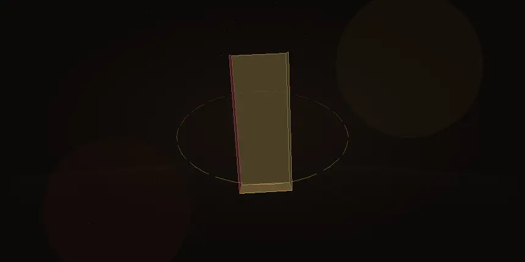
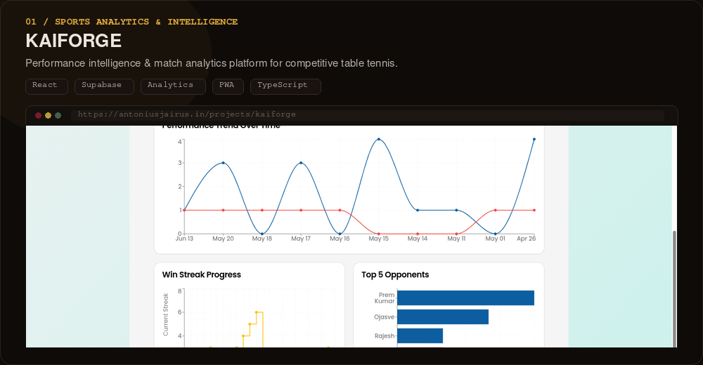
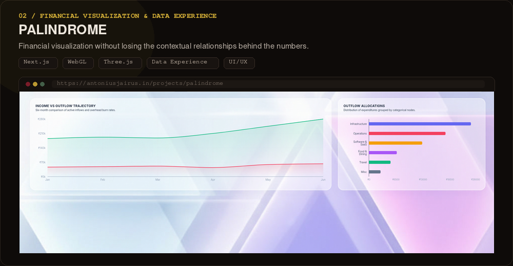
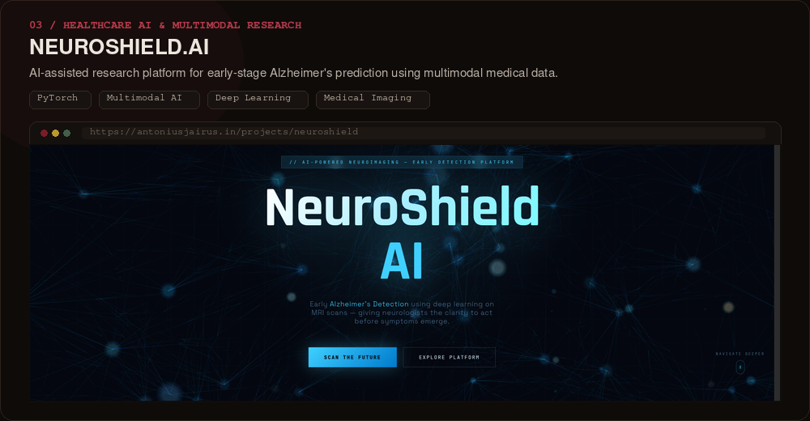
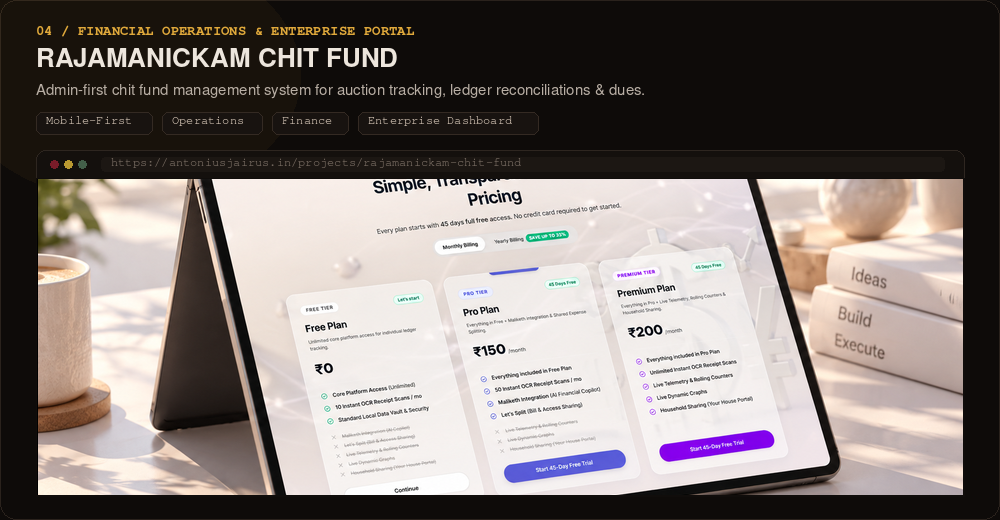
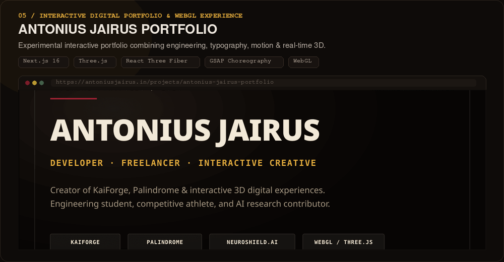
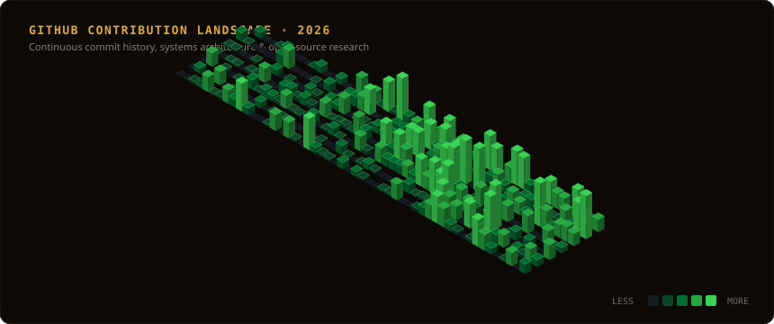

<div align="center">



<br />

# ANTONIUS JAIRUS

### Engineer &nbsp;·&nbsp; Developer &nbsp;·&nbsp; Researcher &nbsp;·&nbsp; Athlete

*Building systems, experiences and ideas that move beyond the ordinary.*

<br />

[](https://antoniusjairus.in)
&nbsp;
[](https://github.com/antoniusjairus4)
&nbsp;
[](https://www.linkedin.com/in/antoniusjairus4)

</div>

<br />

<div align="center">
  
</div>

<br />

## 01 / PERSPECTIVE

I am a **Computer Science engineer**, developer and researcher creating high-performance digital experiences, machine-learning architectures and visual software systems.

My discipline sits at the convergence of **rigorous systems engineering** and **cinematic interactive craft**:

- **Software Engineering & Web Architecture** — Next.js 16, React, TypeScript, Node.js, distributed database design.
- **Artificial Intelligence & Machine Learning** — Deep learning, multimodal fusion, computer vision, diagnostic research.
- **Real-Time 3D & Creative Computing** — WebGL, Three.js, React Three Fiber, GLSL shaders, kinetic scroll choreography.
- **Cybersecurity & Systems** — Linux systems administration, defensive infrastructure, protocol analysis.
- **Product Experience** — High-end editorial visual design, micro-interactions, responsive typography.

---

## 02 / SELECTED WORK

<br />

### 01 &nbsp;·&nbsp; KAIFORGE

**Performance intelligence for competitive table tennis.**

KaiForge transforms daily training, Bo3/Bo5/Bo7 match data, doubles pairings, and tournament progression into actionable predictive insights for elite competitive athletes.

`React` &nbsp;·&nbsp; `Supabase` &nbsp;·&nbsp; `Analytics Architecture` &nbsp;·&nbsp; `PWA` &nbsp;·&nbsp; `TypeScript`

<br />

[](https://antoniusjairus.in/projects/kaiforge)

<div align="right">
  <a href="https://antoniusjairus.in/projects/kaiforge"><b>Explore KaiForge Case Study ↗</b></a>
</div>

<br />

---

<br />

### 02 &nbsp;·&nbsp; PALINDROME

**Financial information without losing the relationships behind the numbers.**

A contextual financial visualization system that reimagines personal wealth tracking through interconnected node topologies rather than static tabular ledgers.

`Next.js` &nbsp;·&nbsp; `WebGL` &nbsp;·&nbsp; `Three.js` &nbsp;·&nbsp; `Data Experience` &nbsp;·&nbsp; `UI/UX`

<br />

[](https://antoniusjairus.in/projects/palindrome)

<div align="right">
  <a href="https://antoniusjairus.in/projects/palindrome"><b>Explore Palindrome Case Study ↗</b></a>
</div>

<br />

---

<br />

### 03 &nbsp;·&nbsp; NEUROSHIELD.AI

**AI-assisted research for Alzheimer's disease prediction.**

A multimodal machine-learning research framework integrating structural MRI, PET, EEG and biomarker metrics for early-stage neurodegenerative condition assessment.

`Python` &nbsp;·&nbsp; `PyTorch` &nbsp;·&nbsp; `Multimodal AI` &nbsp;·&nbsp; `Deep Learning` &nbsp;·&nbsp; `Medical Imaging`

<br />

[](https://antoniusjairus.in/projects/neuroshield)

<div align="right">
  <a href="https://antoniusjairus.in/projects/neuroshield"><b>Explore NeuroShield Case Study ↗</b></a>
</div>

<br />

---

<br />

### 04 &nbsp;·&nbsp; RAJAMANICKAM CHIT FUND

**An admin-first chit fund management system.**

An enterprise operational portal engineered specifically for ledger reconciliation, live auction cycles, defaulter risk modeling, and regulatory reporting across recurring chit groups.

`Mobile-First` &nbsp;·&nbsp; `Financial Operations` &nbsp;·&nbsp; `Admin Portal` &nbsp;·&nbsp; `TypeScript`

<br />

[](https://antoniusjairus.in/projects/rajamanickam-chit-fund)

<div align="right">
  <a href="https://antoniusjairus.in/projects/rajamanickam-chit-fund"><b>Explore Rajamanickam Case Study ↗</b></a>
</div>

<br />

---

<br />

### 05 &nbsp;·&nbsp; ANTONIUS JAIRUS PORTFOLIO

**An experimental interactive portfolio combining engineering, typography, motion and real-time 3D.**

An Awwwards-inspired digital showcase built with real-time WebGL, dynamic physics simulations, kinetic GSAP timelines, responsive art direction across 12 viewports, and static SEO architecture.

`Next.js 16` &nbsp;·&nbsp; `Three.js` &nbsp;·&nbsp; `React Three Fiber` &nbsp;·&nbsp; `GSAP Choreography` &nbsp;·&nbsp; `WebGL`

<br />

[](https://antoniusjairus.in)

<div align="right">
  <a href="https://antoniusjairus.in"><b>Launch Live Interactive Experience ↗</b></a>
</div>

<br />

<div align="center">
  
</div>

<br />

## 03 / TOOLS & SYSTEMS

```text
PROGRAMMING         C++  ·  C  ·  Python  ·  Java  ·  TypeScript  ·  JavaScript  ·  GLSL
FRONTEND            Next.js  ·  React  ·  Tailwind CSS  ·  HTML5  ·  CSS3  ·  Bootstrap
3D & MOTION         Three.js  ·  React Three Fiber  ·  WebGL  ·  GSAP  ·  Lenis Scroll
BACKEND & DATA      Node.js  ·  Express  ·  Supabase  ·  PostgreSQL  ·  MongoDB  ·  REST
AI & RESEARCH       PyTorch  ·  NumPy  ·  Pandas  ·  Deep Learning  ·  Multimodal Fusion
INFRA & WORKFLOW    Linux  ·  Kali Linux  ·  Git  ·  GitHub Actions  ·  VS Code
```

---

## 04 / CONTRIBUTION LANDSCAPE

<div align="center">



</div>

> *Live automated daily 3D landscape rendered via `github-profile-3d-contrib`.*

---

## 05 / BEYOND THE CODE

```text
TABLE TENNIS        2× Tamil Nadu State Champion · Indo-Nepal Championship Gold Medalist
KARATE              Black Belt (Dan 1) · Multiple State & National Championship Medals
CHESS               Competitive online ratings across Bullet, Blitz & Rapid disciplines
PUBLIC SPEAKING     Keynote host & speaker before audiences of 15,000+
```

Athletic discipline and strategic competition directly inform how I engineer software: high endurance under load, instant tactical adaptability, and relentless technical precision.

---

## 06 / CURRENTLY EXPLORING

- **Multimodal AI & Foundation Models** — Cross-attentive neural network fusions between imaging modalities and high-dimensional clinical embeddings.
- **Real-Time WebGL Compute & Shaders** — GPU-accelerated procedural geometry and cinematic volumetric post-processing directly inside browser canvas pipelines.
- **Distributed Edge Computing** — Offline-first local synchronization algorithms with zero-latency optimistic state resolution.

---

## 07 / LET'S BUILD AND SCALE TO THE NEXT LEVEL.

Open for engineering collaborations, research initiatives, and technical leadership:

<br />

<div align="center">

<a href="https://github.com/antoniusjairus4">
  
  &nbsp;<b>GitHub</b>
</a>
&nbsp;&nbsp;&nbsp;&nbsp;&nbsp;&nbsp;&nbsp;&nbsp;
<a href="https://www.linkedin.com/in/antoniusjairus4">
  
  &nbsp;<b>LinkedIn</b>
</a>
&nbsp;&nbsp;&nbsp;&nbsp;&nbsp;&nbsp;&nbsp;&nbsp;
<a href="https://www.instagram.com/antoniusjairus4">
  
  &nbsp;<b>Instagram</b>
</a>
&nbsp;&nbsp;&nbsp;&nbsp;&nbsp;&nbsp;&nbsp;&nbsp;
<a href="https://x.com/antoniusjairus4">
  
  &nbsp;<b>X</b>
</a>
&nbsp;&nbsp;&nbsp;&nbsp;&nbsp;&nbsp;&nbsp;&nbsp;
<a href="mailto:antoniusjairusofficial@gmail.com">
  
  &nbsp;<b>Email</b>
</a>

<br /><br />

`antoniusjairusofficial@gmail.com`

</div>

<br />

---

<div align="center">

<sub>© 2026 Antonius Jairus — Designed &amp; developed by Antonius Jairus</sub>

</div>
