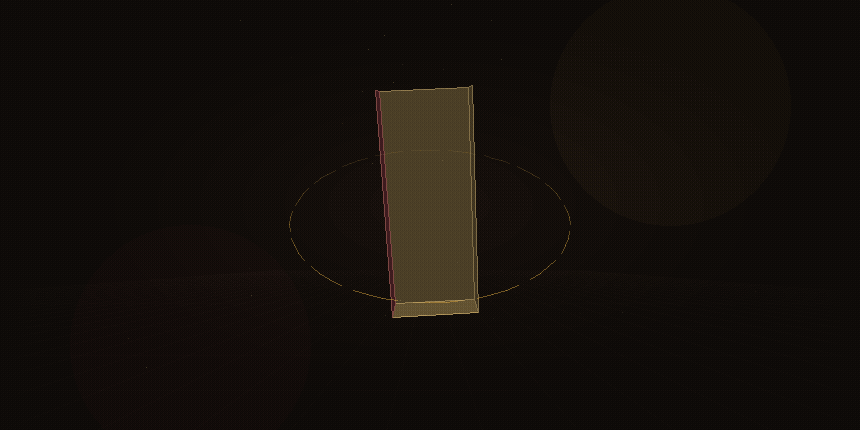
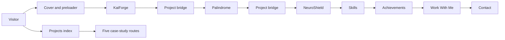
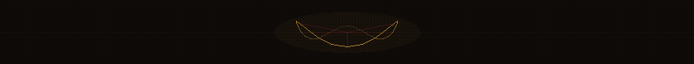
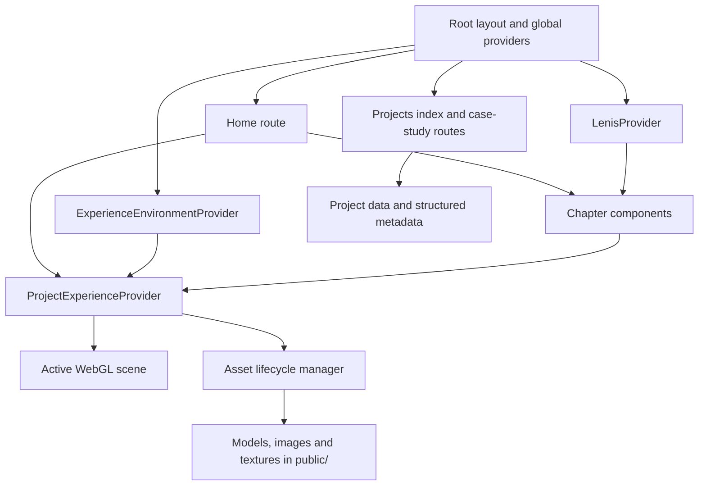
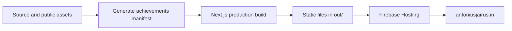

<p align="center">
  <a href="https://antoniusjairus.in"></a>
</p>

<h1 align="center">ANTONIUS JAIRUS / PORTFOLIO</h1>

<p align="center"><strong>An interactive portfolio built as a scroll-driven story.</strong></p>
<p align="center">Next.js · React · TypeScript · WebGL · Motion</p>
<p align="center">
  <a href="https://antoniusjairus.in">Explore the site</a> ·
  <a href="https://antoniusjairus.in/projects">Browse projects</a> ·
  <a href="mailto:antoniusjairusofficial@gmail.com">Get in touch</a>
</p>

---

## The experience

The homepage moves through a cover, three project chapters, skills, achievements, a “Work With Me” transition, and contact. Each chapter combines editorial content with motion; selected chapters add 3D scenes. Project case studies also have their own statically generated pages.



<div align="center">
  
</div>

## Tech stack

| Layer | In this repository |
| --- | --- |
| App | Next.js 16 App Router, React 19, TypeScript |
| 3D | Three.js, React Three Fiber, Drei, React Three Rapier, postprocessing |
| Motion | GSAP, ScrollTrigger, Lenis, Motion |
| Styling | Tailwind CSS 4, CSS modules, local font files |
| Content and discovery | Static project data, Next.js metadata, JSON-LD, sitemap, robots.txt |
| Build and hosting | Next.js static export to `out/`, Firebase Hosting |
| Checks | TypeScript during build, Biome, Vitest, Playwright |

The portfolio adapts its rendering quality to device capability and reduced-motion preferences. The 3D experience is coordinated through shared scene and asset lifecycle code rather than making every chapter render continuously.

## How the pieces connect



## Project map

| Case study | What the portfolio presents |
| --- | --- |
| [KaiForge](https://antoniusjairus.in/projects/kaiforge) | Table-tennis performance tracking and analytics |
| [Palindrome](https://antoniusjairus.in/projects/palindrome) | Consumer financial intelligence |
| [NeuroShield.ai](https://antoniusjairus.in/projects/neuroshield) | MRI-based machine-learning research |
| [Rajamanickam Chit Fund](https://antoniusjairus.in/projects/rajamanickam-chit-fund) | Custom financial operations software |
| [Dr. J.S. Yogesh Kumar](https://antoniusjairus.in/projects/dr-js-yogesh-kumar-zsi) | Scientific archive and portfolio |

## File structure

```text
.
├── .github/readme-assets/     Animated README artwork and project images
├── public/                    Static images, fonts, models and textures
├── scripts/                   Asset generation and capture utilities
├── src/
│   ├── app/                   Routes, root layout, metadata, robots and sitemap
│   │   └── projects/[slug]/   Statically generated project case studies
│   ├── components/            Homepage chapters, transitions and UI
│   ├── content/               Chapter copy and generated achievement manifest
│   ├── experience/            Quality settings, scene coordination, asset lifecycle
│   ├── motion/                GSAP choreography and Lenis scroll integration
│   ├── seo/                   Project data and structured data
│   ├── styles/                Global styles
│   └── webgl/                 Three.js scenes, geometry and shaders
├── tests/                     Unit and browser tests
├── firebase.json              Hosting serves the exported out/ directory
└── next.config.ts             Static export configuration
```

## Run locally

Use Node.js and the pnpm version declared in `package.json`.

```bash
pnpm install
pnpm dev
```

Open `http://localhost:3000`. The development command generates the achievements manifest before starting Next.js.

```bash
pnpm build          # production build and static export to out/
pnpm test           # Vitest
pnpm test:e2e       # Playwright
pnpm lint           # Biome
```

## Build and deployment flow



`next.config.ts` sets `output: 'export'`; `firebase.json` serves `out/`. Build before deploying so Hosting receives the current site.

---

<p align="center">
  Made by Antonius Jairus ·
  <a href="https://antoniusjairus.in">Live portfolio</a> ·
  <a href="https://github.com/antoniusjairus4">GitHub</a> ·
  <a href="https://www.linkedin.com/in/antoniusjairus4">LinkedIn</a>
</p>
